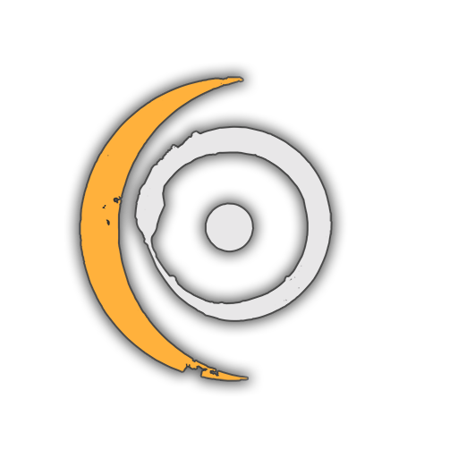

# 📘 AfterHours

[https://kyaulabs.com/](https://kyaulabs.com/)

 &nbsp;  &nbsp;  &nbsp;  
 &nbsp; 

## About

AfterHours is a Fabric modpack for Minecraft Java 26.3. Explore Dungeons and Taverns structures with Complementary Unbound skies, biome ambience, and a visible first-person body. Crafting, combat, and progression follow vanilla survival.

## Play

Download the `.mrpack` from the latest AfterHours prerelease. In Prism Launcher, choose **Add Instance → Import**, select the file, and launch with Java 25. Prism downloads the 24 mods and the shader from their pinned Modrinth files. [GitHub releases](https://github.com/kyaulabs/afterhours/releases)

The starting profile uses Complementary Unbound High through Iris and OpenGL, with a 90 FPS cap, 16 chunks of render distance, and 8 chunks of simulation distance. On the reference PC, set the instance memory to 2048 MiB minimum and 6144 MiB maximum. Prism manages memory separately from the pack archive. [Pack settings and proposed additions](docs/vanilla-plus.md)

## Build

Run `python scripts/build.py --verify-downloads` with Python 3.11 or newer. The importable pack and its SHA-256 checksum appear in `dist/`. The manifest pins Minecraft, Fabric Loader, and each upstream download. Client settings live in `pack/client-overrides/`.

Pull requests build the archive. Merging a release into `main` creates the version tag, publishes a GitHub prerelease, and opens a back-merge PR into `develop`. [Development and release instructions](CONTRIBUTING.md)

## Attribution

KYAU Labs maintains the pack and created the AfterHours artwork. The repository license covers the pack's original files. Each mod and shader retains its upstream license.
